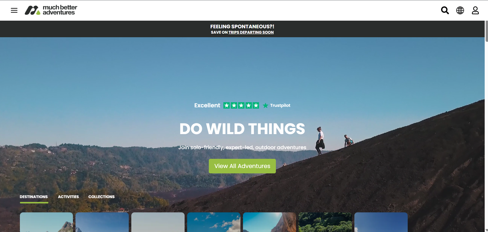
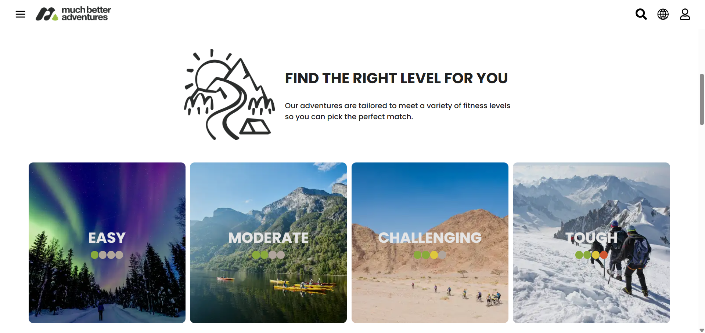
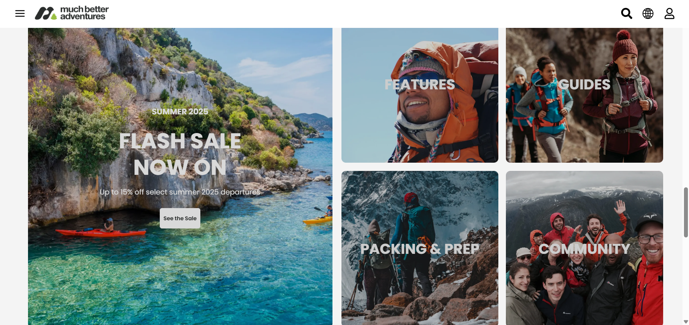
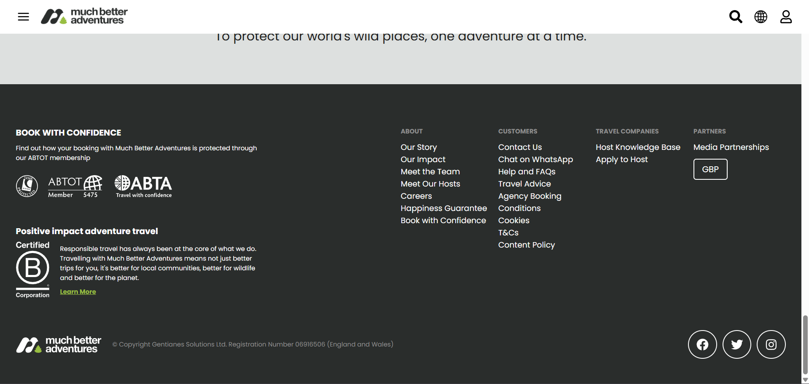

# 🌍 Much Better Adventures - Home Page Clone

This project is a **clone** of the [Much Better Adventures](https://www.muchbetteradventures.com/) **homepage**, created to enhance my **React.js** development skills — especially in building **reusable components**, managing layouts, and creating **responsive** UIs.

---

## 📸 Screenshots

| 🏠 Home Section | 🎚️ Levels Section |
|------------|------------|
|  |  |

|ℹ️ Info Section | 🧩 Footer Section |
|------------|------------|
|  |  |

---

## 🌐 Live Demo

Check out the live version here:

👉 **[React-UI-Practice Live Demo](https://react-ui-practice-nine.vercel.app/)**

Official Website:

🌎 **[Much Better Adventures](https://www.muchbetteradventures.com/)**

---

## ⚙️ Tech Stack

| Technology | Purpose |
|:---|:---|
| **React.js** | Enables component-based UI development using reusable components. |
| **CSS3** | Handles styling, responsive layouts, and modern visual design. |
| **React Icons** | Provides clean and expressive icons throughout the interface. |

---

## ✨ Features

| Feature | Description |
|:---|:---|
| **Fully Responsive Design** | Adapts seamlessly to different screen sizes and devices. |
| **Reusable & Modular Components** | Uses reusable React components for maintainable and organized code. |
| **Real-World UI Inspiration** | Features a clean layout inspired by modern website design. |
| **Structured Code Organization** | Follows a well-organized folder structure and component architecture. |
| **Modern UI Design** | Uses plain CSS to create a smooth, clean, and visually appealing interface. |

---

## 💡 Why I Built This

I created this project to **practice React.js concepts** and strengthen my front-end development skills.  
The main goals were:
- Understanding **component-based architecture**
- Improving **layout and styling** with CSS
- Learning how to **structure and organize** a React project efficiently

---

## 🛠️ Installation & Setup

Follow these steps to run the project locally:

1️⃣ Clone the repository:

```bash
git clone https://github.com/TonyStark-19/react-ui-practice.git
```

2️⃣ Navigate into the project folder:

```bash
cd react-ui-practice
```

3️⃣ Install dependencies:

```bash
npm install
```

4️⃣ Start the development server:

```bash
npm start
```

---

## 📩 Feedback

Got feedback, suggestions, or ideas to improve the UI? <br />
Feel free to open an issue or reach out. Always happy to learn and collaborate! 🚀

---

💡 Built with ❤️ by Aditya chandel
